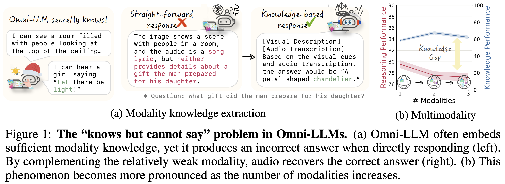

## Omni-Modal LLMs Know More Than They Say

[Na Min An](https://namin-an.github.io/)1*,
[Taekyung Kim](https://taekyungkim918.github.io)2,
[Jaemyung Yu](https://sites.google.com/view/jaemyungyu)2,
[Hyunjung Shim](https://kaist-cvml.github.io/index.html)1,
[Dongyoon Han](https://sites.google.com/site/dyhan0920/)2

1 KAIST AI 2 NAVER AI Lab

&#42; Work done during an internship at NAVER AI Lab.

### Our method - OmniCatalyst

### 💻 Code

> [!NOTE]
> 🔍 The code is currently under internal review and will be released soon. Stay tuned!
